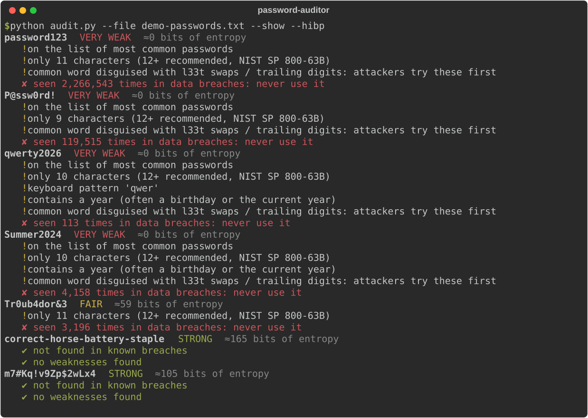
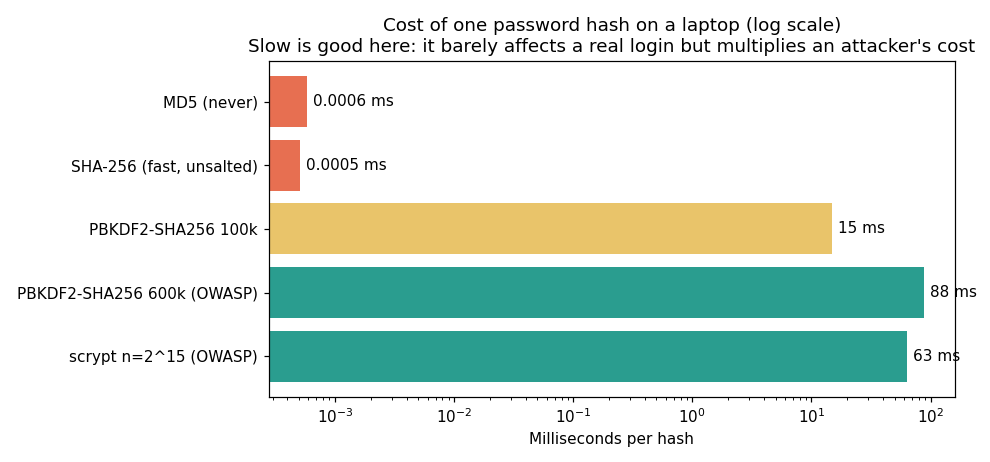

# Password Strength Auditor

**Quick summary:** A Python tool that rates password strength, explains *why* a password is weak, and privately checks it against 800M+ breached passwords using Have I Been Pwned's k-anonymity API. It also benchmarks why passwords must be stored with slow, salted hashes.



## Description
For each password it reports:
- **Entropy estimate:** length × log2(character pool size), minus penalties for predictable patterns
- **Weaknesses:** common-password list, disguised common words (`P@ssw0rd!` → `password`), keyboard walks (`qwer`), repeated characters, years, and length under 12 (NIST SP 800-63B guidance)
- **Breach check** (`--hibp`): has this exact password appeared in a data breach?
- **Rating:** VERY WEAK / WEAK / FAIR / STRONG

**Privacy by design**
- Interactive mode uses `getpass`, so the password is never echoed or saved in shell history.
- The breach check sends **only the first 5 characters of the SHA-1 hash**. The API returns ~800 candidate suffixes and the match happens locally, so the password (and even its full hash) never leaves your machine.
- File mode masks passwords in the output unless `--show` is used on a demo list.

## Tools Used
- **Python** standard library: `hashlib`, `getpass`, `re`, `urllib`, `ssl`
- **Have I Been Pwned Pwned Passwords API** (k-anonymity range search)
- **Matplotlib**: storage benchmark chart

## Scope
Defensive auditing of passwords you own or of a policy test list. Integration with a real signup form is future work.

## Objective
Understand what actually makes a password strong, and how organizations should check and store passwords, which is core material for Security+ and any IT role that manages accounts.

## Result
- The breach check revealed that even "complex-looking" passwords are burned: `Tr0ub4dor&3` appears **3,196 times** in breaches, and `P@ssw0rd!` appears **119,515 times**.
- Long passphrases (`correct-horse-battery-staple`) score far higher than short "complex" passwords.
- Storage benchmark on my laptop:

| Algorithm | Time per hash | Guesses/sec on one core |
|---|---|---|
| MD5 | 0.0006 ms | ~1,700,000 |
| SHA-256 (unsalted) | 0.0005 ms | ~2,000,000 |
| PBKDF2-SHA256, 600k iterations (OWASP) | 88 ms | ~11 |
| scrypt, n = 2^15 (OWASP) | 63 ms | ~16 |



A user logging in waits under 0.1 s. Someone who steals the database gets ~150,000× fewer guesses per second than with plain SHA-256.

## What I Learned
- **Length beats complexity.** Every extra character multiplies the possibilities, while "complexity rules" push people into predictable patterns like `Summer2024!`.
- **Breach data is the real test:** a password can "look" strong and still be in every attacker's wordlist.
- **k-anonymity** lets you check something sensitive against a remote database without revealing it.
- **Hashing for files ≠ hashing for passwords:** SHA-256 is designed to be fast (great for integrity checks), which is exactly wrong for passwords. Password storage needs a **salt** (unique per user) and a **slow** algorithm (PBKDF2, scrypt, bcrypt, Argon2).
- A real-world bug: python.org's macOS Python has no CA certificates, so HTTPS failed until I loaded `certifi`'s bundle. I also caught an ordering bug where undoing l33t swaps *before* stripping digits turned `2024` into `2o24`.

## Run It
```bash
pip install -r requirements.txt
python audit.py --hibp                                  # hidden prompt
python audit.py --file demo-passwords.txt --show --hibp
python storage_benchmark.py
python test_audit.py
```
